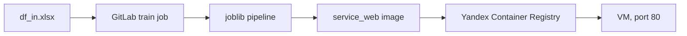

# Event proposal classifier

FastAPI form that scores an event request. A logistic regression pipeline estimates the probability that the status is Released.

The page collects source, agency flag, event format, received and event dates, guest count, venue and restaurant closure flags, budget, venues, meals, and managers. Before inference the app adds event duration, process duration, and counts of selected venues, meals, and managers.

## Request path


`service_web/main.py` loads `service_model/full_model_pipeline.joblib` and calls `predict_proba`. The positive class is shown as Released. There is no separate predict service. Preprocessing is inside the saved pipeline.

The pipeline, built in `service_model/train.py`:

- Date columns become year, weekend flag, and sine or cosine of month and weekday.
- String columns are imputed and one-hot encoded.
- Skewed counts and the budget use `log1p`.
- Binary venue, meal, and manager flags are imputed with 0.
- Remaining numeric columns pass through.
- `StandardScaler`, then a VIF filter with threshold 5.
- Logistic regression, `liblinear`, `class_weight='balanced'`.

Training uses `df_in.xlsx`, target `flag_status_event`, and a stratified 80/20 split (`random_state=42`). The script logs macro F1 to MLflow and writes the joblib next to the spreadsheet. The checked-in joblib is that artifact. The split is random, not by date.

## Train and deploy



`gitlab-ci.yml` has three stages:

1. `train` installs `service_model/requirements.txt` and runs `service_model/train.py`. Artifacts are the joblib and `mlruns/`.
2. `build` logs in to `cr.yandex` with `$YC_KEY_JSON`, builds `service_web/Dockerfile`, and pushes `$IMAGE_NAME`.
3. `deploy` copies the key to the VM over SSH and runs the image as `web-app` on port 80.

`IMAGE_NAME` and `VM_USER` in the file are placeholders. `$VM_IP` and `$ID_ED25519` come from CI variables. `service_model/Dockerfile` is not used by this pipeline.

## Layout

```
gitlab-ci.yml
service_model/
  train.py
  df_in.xlsx
  full_model_pipeline.joblib
  requirements.txt
  Dockerfile
service_web/
  main.py
  Dockerfile
  requirements.txt
  templates/index.html
```
